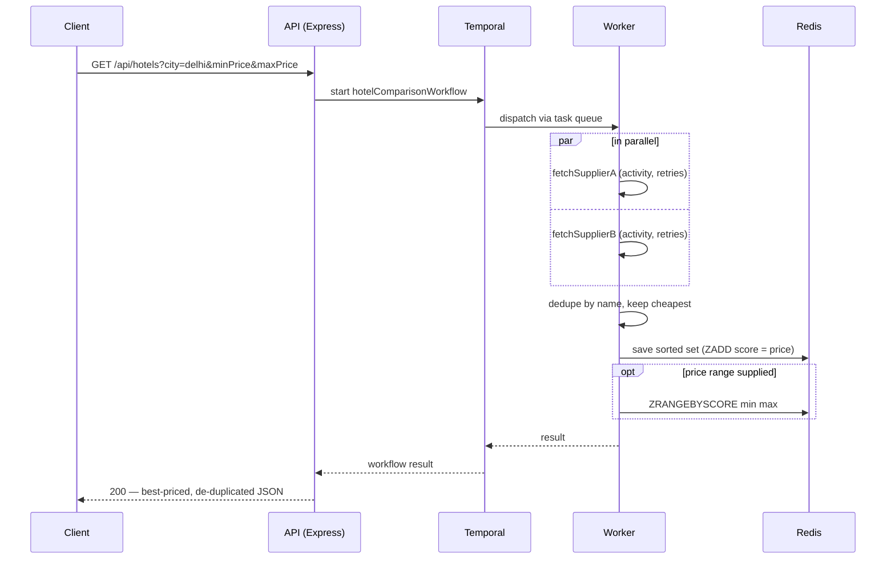

# Hotel Offer Orchestrator


Aggregate overlapping hotel offers from two mock suppliers, de-duplicate by
name, and return the **best-priced** offer per hotel. The comparison is
orchestrated with **Temporal**; the de-duplicated listing is stored in **Redis**,
where price-range filtering is performed.

**Stack:** Node.js (TypeScript) · Express · Temporal · Redis · Docker Compose

---

## Contents

- [Quick start](#quick-start)
- [Requirements coverage](#requirements-coverage)
- [Architecture](#architecture)
- [API reference](#api-reference)
- [Running the project](#running-the-project)
- [Testing](#testing)
- [Inspecting Redis directly](#inspecting-redis-directly)
- [Configuration](#configuration)
- [Project layout](#project-layout)
- [Design decisions & trade-offs](#design-decisions--trade-offs)
- [Troubleshooting](#troubleshooting)

---

## Quick start

Requires **Docker** and **Docker Compose v2**. From the project root:

```bash
docker compose up -d --build
# first boot pulls images + provisions Temporal (~30–60s)
curl "http://localhost:3000/api/hotels?city=delhi"
```

That's it — the single command brings up the API, the Temporal worker, the
Temporal server (+ Postgres + Web UI), and Redis. Stop everything with
`docker compose down -v`.

---

## Requirements coverage

| Requirement | Status | Where |
|---|---|---|
| `GET /api/hotels?city=…` orchestrated with Temporal | ✅ | `src/temporal/workflows.ts`, `src/api/routes/hotels.ts` |
| Call Supplier A & B **in parallel** | ✅ | `Promise.all` of two activities in the workflow |
| De-duplicate by name, keep the **cheaper** price | ✅ | `src/domain/dedupe.ts` |
| Keep the single offer if only one supplier has it | ✅ | `dedupeCheapest` + graceful one-down handling |
| Price-range filter, list **saved in Redis** | ✅ | `saveDedupedListToRedis` activity |
| Filtering performed **inside Redis** | ✅ | `ZRANGEBYSCORE` in `filterByPriceFromRedis` |
| Mock suppliers with overlapping names | ✅ | `src/data/mockHotels.ts`, `src/api/routes/suppliers.ts` |
| Response shape `{ name, price, supplier, commissionPct }` | ✅ | `src/types.ts` |
| Containerized with Docker Compose | ✅ | `Dockerfile`, `docker-compose.yml` |
| Postman collection (overlaps / no results / supplier down) | ✅ | `postman/` |
| **Bonus:** `/health` reports both suppliers | ✅ | `src/api/routes/health.ts` |
| **Bonus:** logging & error handling in activities/workflow | ✅ | retries + structured logs throughout |
| Unit test for the de-dupe logic | ✅ (extra) | `src/domain/dedupe.test.ts` |

---

## Architecture



**Services** (all defined in `docker-compose.yml`):

| Service | Port | Purpose |
|---|---|---|
| `api` | 3000 | Express API + mock suppliers + `/health` |
| `worker` | — | Temporal worker: runs the workflow and activities |
| `temporal` | 7233 | Temporal server |
| `temporal-ui` | 8080 | Temporal Web UI — http://localhost:8080 |
| `postgresql` | — | Temporal persistence |
| `redis` | 6379 | De-duplicated store + price filtering |

### How it works

- **`/api/hotels`** starts `hotelComparisonWorkflow` and waits for its result.
- Supplier A and Supplier B are called **in parallel** as Temporal **activities**,
  each with an automatic retry policy.
- **De-duplication by name** keeps the **cheaper** offer. If only one supplier
  returns a hotel, that one is kept. This rule is pure and deterministic
  (`dedupeCheapest`), so it lives in the workflow and is unit-tested in isolation.
- The de-duplicated list is **saved to Redis** as a sorted set scored by price,
  plus one JSON key per hotel.
- When `minPrice`/`maxPrice` are supplied, **filtering runs inside Redis** via
  `ZRANGEBYSCORE` — not in application code.
- If **one supplier is down**, the workflow proceeds with the other; if **both**
  are down, the API returns `502`.

---

## API reference

| Method & path | Description |
|---|---|
| `GET /api/hotels?city=delhi` | De-duplicated, best-priced list for a city |
| `GET /api/hotels?city=delhi&minPrice=<min>&maxPrice=<max>` | Same, price-filtered inside Redis |
| `GET /api/hotels?city=delhi&down=A` | Simulate a supplier offline (`down=A` or `down=B`) |
| `GET /supplierA/hotels?city=delhi` | Mock Supplier A (add `&down=true` to force a 503) |
| `GET /supplierB/hotels?city=delhi` | Mock Supplier B |
| `GET /health` | Service health + reachability of both suppliers |

### Examples

**Best-priced, de-duplicated list** — `GET /api/hotels?city=delhi`

```json
[
  { "name": "Marrot",  "price": 3900, "supplier": "Supplier B", "commissionPct": 12 },
  { "name": "Taz",     "price": 4200, "supplier": "Supplier A", "commissionPct": 8 },
  { "name": "Holtin",  "price": 5340, "supplier": "Supplier B", "commissionPct": 20 },
  { "name": "Radison", "price": 5900, "supplier": "Supplier A", "commissionPct": 13 }
]
```

`Holtin` and `Radison` exist in **both** suppliers; the cheaper offer wins
(Holtin → Supplier B @ 5340, Radison → Supplier A @ 5900). Results are sorted by
ascending price.

**Filtered inside Redis** — `GET /api/hotels?city=delhi&minPrice=4000&maxPrice=6000`

```json
[
  { "name": "Taz",     "price": 4200, "supplier": "Supplier A", "commissionPct": 8 },
  { "name": "Holtin",  "price": 5340, "supplier": "Supplier B", "commissionPct": 20 },
  { "name": "Radison", "price": 5900, "supplier": "Supplier A", "commissionPct": 13 }
]
```

**One supplier down** — `GET /api/hotels?city=delhi&down=A` (everything falls back to B)

```json
[
  { "name": "Marrot",  "price": 3900, "supplier": "Supplier B", "commissionPct": 12 },
  { "name": "Holtin",  "price": 5340, "supplier": "Supplier B", "commissionPct": 20 },
  { "name": "Radison", "price": 6100, "supplier": "Supplier B", "commissionPct": 9 }
]
```

**No results** — `GET /api/hotels?city=jaipur` → `[]`

**Health** — `GET /health`

```json
{
  "status": "ok",
  "suppliers": { "Supplier A": "up", "Supplier B": "up" },
  "timestamp": "2026-11-21T09:22:41.934Z"
}
```

---

## Running the project

### With Docker Compose (recommended)

```bash
docker compose up -d --build
```

Try it:

```bash
curl "http://localhost:3000/api/hotels?city=delhi"
curl "http://localhost:3000/api/hotels?city=delhi&minPrice=4000&maxPrice=6000"
curl "http://localhost:3000/api/hotels?city=delhi&down=A"
curl "http://localhost:3000/health"
```

> First boot takes ~30–60s while Temporal provisions its schema. The `api` and
> `worker` retry the Temporal connection automatically until it is ready, so the
> start-up order doesn't matter.

Watch the orchestration in the **Temporal Web UI** at http://localhost:8080.

Tear everything down (and wipe Temporal's Postgres volume):

```bash
docker compose down -v
```

### Locally (without Docker)

You'll need a Temporal dev server and a Redis instance running:

```bash
# 1. Temporal dev server (Temporal CLI — https://docs.temporal.io/cli)
temporal server start-dev            # serves 7233, UI on 8233

# 2. Redis
redis-server                         # or: docker run -p 6379:6379 redis:7-alpine

# 3. Install, build, and start the two processes (separate terminals)
npm install
cp .env.example .env
npm run build
npm run start:worker                 # Temporal worker
npm run start:api                    # Express API on :3000
```

For hot-reload during development, use `npm run dev:worker` and `npm run dev:api`.

---

## Testing

### Postman

Import `postman/HotelOfferOrchestrator.postman_collection.json`. It ships with
tests (assertions) for:

- **Hotels - Delhi (expected overlaps)** — de-dupe + cheapest selection
- **Hotels - Delhi filtered by price range (Redis)** — Redis filtering
- **Hotels - City with no results** — empty-array case (`city=jaipur`)
- **Hotels - Simulate Supplier A down** — `down=A`, all results fall back to B
- **Supplier A / B - raw hotels** — the mock catalogues
- **Health** — both suppliers reported `up`

The collection uses a `baseUrl` variable defaulting to `http://localhost:3000`.

> **Note on the "supplier down" request:** `?down=A` deliberately exercises the
> retry path, so the workflow retries the downed supplier (500ms → 1s backoff)
> before giving up and returning the other supplier's results. That request
> takes **~2–2.5 seconds** to come back (vs ~100ms normally) — it isn't hung,
> it's retrying. The healthy supplier is fetched in parallel, so nothing else is
> blocked.

### Unit tests

The core de-dupe / cheapest-selection rule is a pure function
(`src/domain/dedupe.ts`) covered by unit tests using Node's built-in test runner
(no extra test framework):

```bash
npm test
```

Cases covered: cheaper-of-two wins, single-supplier hotel kept, the assessment's
delhi sample, case-insensitive names, exact-price tie-break (Supplier A wins),
empty input, and ascending-price ordering.

---

## Inspecting Redis directly

You can confirm the de-duplicated list really lives in Redis and that filtering
happens there:

```bash
# the sorted set: member = hotel name, score = price
docker compose exec redis redis-cli ZRANGE hotels:delhi:byprice 0 -1 WITHSCORES
# 1) "Marrot"  2) "3900"  3) "Taz"  4) "4200"
# 5) "Holtin"  6) "5340"  7) "Radison" 8) "5900"

# the exact filter the API runs for minPrice=4000 maxPrice=6000
docker compose exec redis redis-cli ZRANGEBYSCORE hotels:delhi:byprice 4000 6000
# 1) "Taz"  2) "Holtin"  3) "Radison"

# the full JSON stored per hotel
docker compose exec redis redis-cli GET hotel:delhi:holtin
# {"name":"Holtin","price":5340,"supplier":"Supplier B","commissionPct":20}
```

---

## Configuration

All configuration is environment-driven (see `.env.example`):

| Variable | Default | Notes |
|---|---|---|
| `API_PORT` | `3000` | Express port |
| `SUPPLIER_BASE_URL` | `http://localhost:3000` | Where activities reach the suppliers (`http://api:3000` in Docker) |
| `TEMPORAL_ADDRESS` | `localhost:7233` | Temporal frontend |
| `TEMPORAL_NAMESPACE` | `default` | |
| `TEMPORAL_TASK_QUEUE` | `hotel-orchestrator` | |
| `REDIS_URL` | `redis://localhost:6379` | |
| `REDIS_TTL_SECONDS` | `300` | TTL for cached city listings |

---

## Project layout

```
src/
  api/
    server.ts              Express bootstrap + routing
    routes/hotels.ts       GET /api/hotels (starts the workflow)
    routes/suppliers.ts    Mock GET /supplierA|B/hotels
    routes/health.ts       GET /health
  temporal/
    client.ts              Temporal client (lazy, retrying)
    worker.ts              Worker entrypoint
    workflows.ts           hotelComparisonWorkflow (dedupe + cheapest)
    activities.ts          fetch suppliers, save to Redis, filter in Redis
  domain/
    dedupe.ts              Pure de-dupe + cheapest-selection rule
    dedupe.test.ts         Unit tests (node:test)
  redis/client.ts          ioredis connection + key helpers
  data/mockHotels.ts       Static supplier catalogues (overlapping names)
  config.ts                Env-driven configuration
  types.ts                 Shared domain types
Dockerfile                 Multi-stage build (one image, two commands)
docker-compose.yml         Full stack
postman/                   Postman collection (.json)
```

---

## Design decisions & trade-offs

- **Deterministic logic in the workflow, side effects in activities.** The
  de-dupe/cheapest rule is pure, so it runs directly in the workflow and is
  unit-tested. HTTP calls and Redis writes are activities, keeping the workflow
  replay-safe.
- **Filtering genuinely runs in Redis.** A sorted set scored by price
  (`ZADD` / `ZRANGEBYSCORE`) does the range query; the app only hydrates the
  matching JSON blobs afterwards.
- **Resilient to a supplier outage.** Each supplier activity retries up to 3
  times (500ms initial, exponential backoff). A persistently failing supplier is
  tolerated as long as the other responds; both down → `502`.
- **One image, two processes.** `api` and `worker` share a single Docker image
  built once, differing only by start command — less to build and keep in sync.
- **Health-gated startup order.** Compose healthchecks make the ordering
  self-documenting: `temporal` is probed with `temporal operator cluster health`,
  `api` with its own `/health` endpoint, and dependants wait on
  `condition: service_healthy` rather than relying solely on app-level retries.

---

## Troubleshooting

- **`502` right after start-up** — Temporal is still provisioning its schema on
  first boot. Give it ~30–60s; the services reconnect automatically.
- **Port already in use (3000 / 7233 / 6379 / 8080)** — stop the conflicting
  process or change the host port mappings in `docker-compose.yml`.
- **Build runs out of memory** — the Temporal SDK has a heavy native dependency.
  Give Docker Desktop ≥ 4 GB (Settings → Resources) if the build is killed.
- **Reset everything** — `docker compose down -v` removes containers and the
  Temporal Postgres volume for a clean slate.
```
